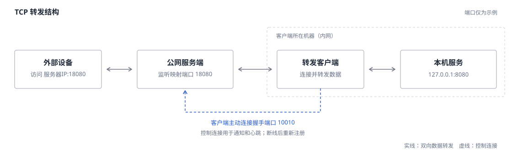
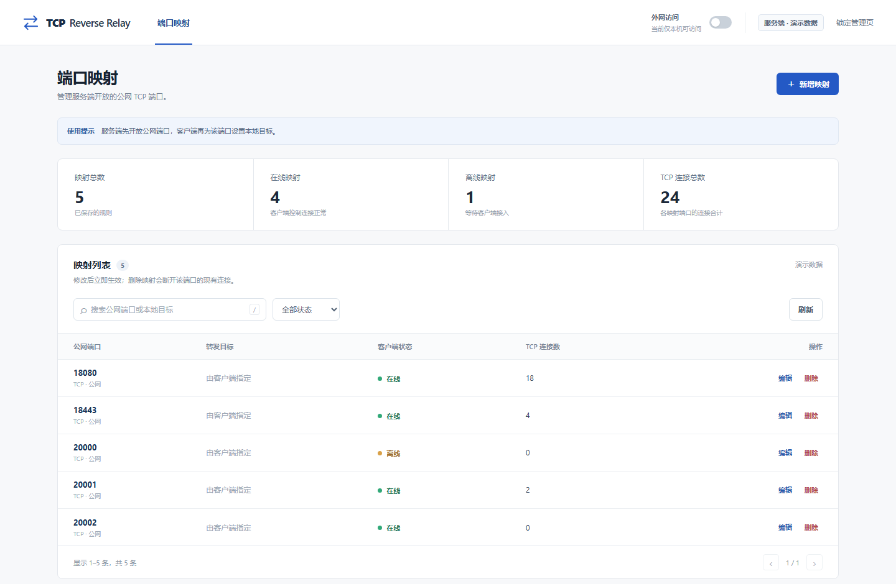
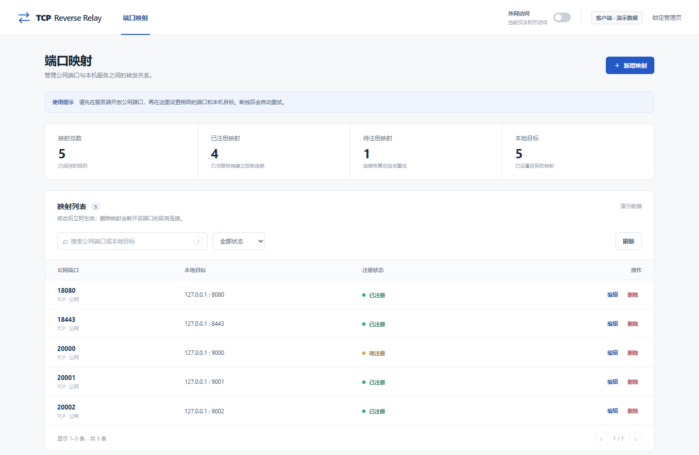

# TCP Reverse Relay

把客户端电脑上的 TCP 服务开放到有公网地址的服务器。客户端主动连接服务器，无需在客户端开放入站端口。



例如：客户端本机的 `127.0.0.1:8080` 映射到服务器的 `18080` 后，外部设备访问 `服务器IP:18080`，就能连接到该服务。HTTP 和其他基于
TCP 的服务都可以转发。

## 功能

| 功能         | 说明                                                     |
|--------------|----------------------------------------------------------|
| 多端口转发   | 服务端开放公网端口，客户端指定每个端口对应的本机目标端口 |
| 浏览器管理   | 两端都有管理页，可新增、修改、删除映射；保存后立即应用   |
| 自动恢复     | 连接断开后客户端持续重试，恢复后重新注册已保存的映射     |
| 通信模式     | 提供明文、控制连接加密、两端通信加密三种模式             |
| 外网管理开关 | 管理页默认仅本机可访问，登录后可开启或关闭外网访问       |

服务端只保存允许开放的公网端口；本地目标地址固定为客户端的 `127.0.0.1`，由客户端填写目标端口。

## 快速开始

需要 **Java 17**；从源码构建还需要 **Maven 3**。服务端需有客户端可访问的地址，并在防火墙中放行握手端口及所需映射端口。

1. 在项目根目录构建两个 JAR：

   ```powershell
   mvn -PserverApp package
   mvn -PclientApp package
   ```

2. 将 `target/TCPReverseRelayServer.jar` 放到服务端，将 `target/TCPReverseRelayClient.jar` 放到客户端。分别启动一次，程序会在
   **当前工作目录**生成 `config/server.properties` 和 `config/client.properties`：

   ```powershell
   java -jar TCPReverseRelayServer.jar
   java -jar TCPReverseRelayClient.jar
   ```

3. 编辑各自生成的配置文件。将客户端的 `server.host` 改为服务器地址，确认两端的 `handshake.port` 一致，然后重新启动。默认示例将服务器
   `18080` 转发到客户端本机 `8080`。

4. 在客户端本机运行目标服务。外部设备连接 `服务器IP:18080` 即可访问。若目标服务是 HTTP，可在浏览器中打开
   `http://服务器IP:18080`。

首次启动时的默认模式是 `simple`，没有握手认证。公网部署建议改用 `secretAll`，并按下文填写两端相同的通信密钥。

## 配置一览

只编辑运行目录下的 `config/*.properties`。`src/main/resources/*.properties` 是打包进 JAR 的默认模板；已有的外部配置不会被覆盖。

| 配置项           | 服务端示例  | 客户端示例     | 说明                                                         |
|------------------|-------------|----------------|--------------------------------------------------------------|
| `mode`           | `secretAll` | `secretAll`    | 两端相同；默认 `simple`                                      |
| `AES_KEY`        | 相同的密钥  | 相同的密钥     | 加密两端通信；`secret` / `secretAll` 必填                    |
| `TOKEN_KEY`      | 相同的密钥  | 相同的密钥     | 给握手等控制消息签名；`secret` / `secretAll` 必填            |
| `ADMIN_TOKEN`    | 可留空      | 可留空         | **各自管理页的密码，可不同**；留空时首次在本机打开管理页设置 |
| `handshake.port` | `10010`     | `10010`        | 客户端连接服务端的端口，两端相同                             |
| `server.host`    | —           | `203.0.113.10` | 服务端 IP 或域名；地址仅为示例                               |
| `admin.port`     | `19090`     | `19091`        | 各自管理页的端口                                             |
| `admin.public`   | `false`     | `false`        | 是否允许其他设备访问管理页；也可在页面中切换                 |
| `forwards`       | `18080`     | `18080:8080`   | 服务端开放端口；客户端填写“公网端口:本机端口”                |

`TOKEN_KEY` 是两端通信时共同持有的签名密钥， **不是后台密码**。两端的 `ADMIN_TOKEN` 互不影响，可以分别设置。首次设置管理密码要求
8 至 128 个字符。

### 通信模式与密钥

| 模式        | 握手与认证   | 两端之间的转发数据 | 密钥                   |
|-------------|--------------|--------------------|------------------------|
| `simple`    | 明文，无认证 | 明文               | 不需要                 |
| `secret`    | 加密并验签   | 明文               | `AES_KEY`、`TOKEN_KEY` |
| `secretAll` | 加密并验签   | 加密               | `AES_KEY`、`TOKEN_KEY` |

使用 `secret` 或 `secretAll` 时，可运行以下命令分别生成密钥，并把输出填入 **两端**的配置文件：

```powershell
python -c "import base64,secrets; print(base64.b64encode(secrets.token_bytes(32)).decode())" # AES_KEY
python -c "import secrets; print(secrets.token_hex(32))" # TOKEN_KEY
```

`AES_KEY` 须为 Base64 编码，解码后长度为 16、24 或 32 字节；`TOKEN_KEY` 至少 32 个字符。不要将真实密钥写进
`src/main/resources` 或提交到 Git。修改模式或密钥后，两端都要重启。

`secretAll` 只加密 **服务端与客户端之间**的数据；外部设备到服务端、客户端到本机目标服务的连接是否加密，取决于目标服务使用的协议。

### 端口写法

| 位置              | 示例                    | 含义                                 |
|-------------------|-------------------------|--------------------------------------|
| 服务端 `forwards` | `18080,20000-20010`     | 开放 `18080` 以及 `20000` 到 `20009` |
| 客户端 `forwards` | `18080:8080,20000:9000` | 分别转发到本机 `8080`、`9000`        |

区间采用“含起点、不含终点”的写法：`10000-12000` 表示 2000 个端口。它不能与握手端口或管理端口冲突；若用这个区间，请先将默认握手端口
`10010` 改到区间外。服务端最多配置 4096 个转发端口，每个端口都会实际创建监听。两端的 `forwards` 都可留空，之后从管理页添加。

## 管理映射

| 程序   | 本机管理地址              | 管理内容                             |
|--------|---------------------------|--------------------------------------|
| 服务端 | `http://127.0.0.1:19090/` | 开放、修改、删除公网端口             |
| 客户端 | `http://127.0.0.1:19091/` | 设置公网端口与本机目标端口的对应关系 |

首次访问先设置管理密码。新增映射时，先在服务端开放公网端口，再在客户端添加相同的公网端口和本机目标端口。页面修改会立即保存到对应的配置文件；客户端断线重连后会恢复已保存的映射。服务端未开放端口时，客户端会保留配置并持续重试。

| 服务端字段 | 含义 |
| --- | --- |
| 客户端状态 | “在线”表示该端口的客户端控制连接正常，不代表本机目标服务已通过健康检查。 |
| TCP 连接数 | 当前保留的外部 TCP 连接，含等待接通的连接；不含控制连接，不是访问人数或累计请求数。 |

**服务端管理页**：开放公网端口，查看端口状态。



**客户端管理页**：指定公网端口对应的本机服务。



*图片使用演示数据，端口和连接数不代表实际运行状态。*

管理页顶部的“外网访问”开关会立即生效，并保存到 `admin.public`。默认关闭；开启后还需自行放行防火墙中的管理端口。当前管理页使用
HTTP，如需从公网使用，建议通过 HTTPS 反向代理或 VPN 访问。

| 修改方式                                           | 是否立即生效                                 |
|----------------------------------------------------|----------------------------------------------|
| 在管理页修改映射或外网访问开关                     | 是，且自动保存                               |
| 直接编辑 `forwards` 或 `admin.public`              | 重启对应程序后生效                           |
| 修改模式、通信密钥、握手端口、服务端地址、管理端口 | 重启对应程序后生效；两端共有的配置需保持一致 |

修改或删除公网端口会断开该映射的现有连接；仅修改客户端的本机目标端口只影响新连接。端口被占用或配置无效时，程序会提示错误。

## 项目结构

| 位置                                                                                                                                                         | 用途                                                      |
|--------------------------------------------------------------------------------------------------------------------------------------------------------------|-----------------------------------------------------------|
| [`ServerApp.java`](src/main/java/dev/sunwenqi/tcpreverserelay/ServerApp.java)、[`ClientApp.java`](src/main/java/dev/sunwenqi/tcpreverserelay/ClientApp.java) | 两个程序的入口                                            |
| [`config/`](src/main/java/dev/sunwenqi/tcpreverserelay/config/)                                                                                              | 读取、校验和保存配置                                      |
| [`serverside/`](src/main/java/dev/sunwenqi/tcpreverserelay/serverside/)、[`clientside/`](src/main/java/dev/sunwenqi/tcpreverserelay/clientside/)             | 端口监听、控制连接和转发                                  |
| [`management/`](src/main/java/dev/sunwenqi/tcpreverserelay/management/)                                                                                      | 管理页接口；页面文件位于 `src/main/resources/management/` |

从旧版命令行输入迁移时，将原来的握手端口、服务端地址和映射端口填入生成的 `config/*.properties`。如果旧版配置文件位于项目根目录，请移到对应的
`config` 目录。程序不再从环境变量读取 `AES_KEY`、`TOKEN_KEY`。
